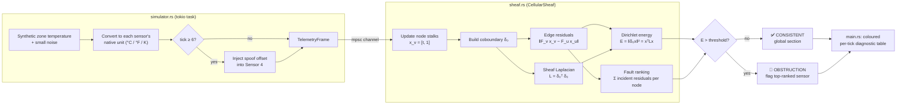
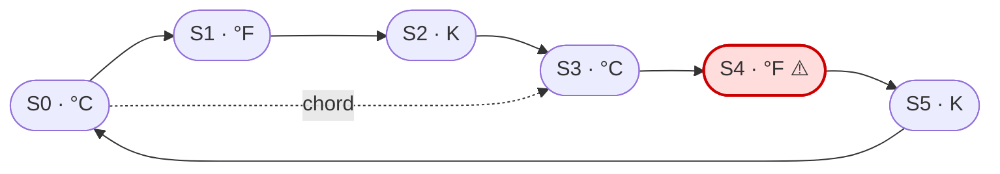

# cohomology-guard

**Real-time sensor-network anomaly detection using cellular sheaves, coboundary operators, and the sheaf Laplacian.**

`cohomology-guard` watches a network of temperature sensors that report in **different units** (°C, °F, K) and monitor the **same thermal zone**. It models the network as a *cellular sheaf*. When the sensors agree after unit conversion, the readings form a **global section** and the Dirichlet energy is ≈ 0. When one sensor is spoofed or broken, the energy spikes and the detector **identifies which sensor caused it**.

---

## How it works (at a glance)



### The sensor network

Six sensors in a ring, plus one chord, so the graph has more than one independent loop. Every edge compares its two endpoints in a shared **°C** space.



Sensor **S4** is the one that gets spoofed from tick 6 onward.

### What a fault looks like

Numbers on the edges are residuals in °C (values from a real run).

```text
  HEALTHY  (ticks 1–5)                    FAULTY  (ticks 6–10)

        S0 ── 0.01 ── S1                       S0 ── 0.01 ── S1
       ╱  ╲             ╲                     ╱  ╲             ╲
    0.00   ╲             0.01              0.01   ╲             0.01
     ╱     0.00            ╲                ╱     0.01            ╲
   S5         ╲             S2            S5         ╲             S2
     ╲         ╲           ╱                ╲╲         ╲           ╱
    0.00        ╲       0.01               15.0╲        ╲       0.01
       ╲         ╲     ╱                     ╲╲         ╲     ╱
        S4 ── 0.01 ── S3                     [S4]══ 15.0 ══ S3
                                                ▲
                                                └─ suspected fault
                                                   (score ≈ 30, neighbours ≈ 15)

   E = ‖δ₀x‖² ≈ 0.0003 °C²                  E = ‖δ₀x‖² ≈ 450 – 670 °C²
```

Each edge residual is the difference in °C between its two endpoints. A single bad sensor makes **every edge touching it** disagree, while all other edges stay near zero. Adding up the residuals at each node therefore points straight at the culprit.

---

## The math

| Concept | In this project |
|---|---|
| **Vertex stalk** `F(v)` | `ℝ²`, holding the reading in homogeneous form `x_v = [t, 1]ᵀ` (`t` is in the sensor's native unit) |
| **Edge stalk** `F(e)` | `ℝ¹`, the temperature in °C |
| **Restriction map** `F_{v ⊴ e}` | 1×2 unit-conversion matrix. The homogeneous `1` lets affine conversions be linear |
| **Coboundary** `δ₀` | `(δ₀ x)_e = F_{v⊴e} x_v − F_{u⊴e} x_u` for an oriented edge `e = u → v` |
| **Sheaf Laplacian** | `L_F = δ₀ᵀ δ₀` |
| **Dirichlet energy** | `E(x) = xᵀ L_F x = ‖δ₀ x‖²`, which is zero ⇔ `x` is a global section |
| **Fault score** | `score(v) = Σ_{e ∋ v} ‖(δ₀ x)_e‖` |

Restriction maps used for the conversion to °C:

```text
Celsius     [ 1      0       ]   ·  [t, 1]ᵀ  =  t
Fahrenheit  [ 5/9   −160/9   ]   ·  [t, 1]ᵀ  =  (t − 32) · 5/9
Kelvin      [ 1     −273.15  ]   ·  [t, 1]ᵀ  =  t − 273.15
```

> **Note on terminology:** the CLI prints `OBSTRUCTION (H¹ ≠ 0)` as shorthand. Strictly, high energy means the *current readings are not a global section*. The code does not compute cohomology groups explicitly.

---

## Project structure

```text
cohomology-guard/
├── Cargo.toml
├── README.md
└── src/
    ├── main.rs        # CLI: runs the async loop and prints the per-tick diagnostics
    ├── sheaf.rs       # CellularSheaf, NodeStalk, EdgeRestriction, δ₀, L_F, consistency report and tests
    └── simulator.rs   # 6-sensor network builder and tokio telemetry stream with fault injection
```

| Module | Key items |
|---|---|
| `sheaf.rs` | `CellularSheaf` (wraps `petgraph::Graph<NodeStalk, EdgeRestriction>`), `compute_coboundary_matrix`, `compute_sheaf_laplacian`, `evaluate_consistency → ConsistencyReport` |
| `simulator.rs` | `build_ring_network`, `spawn_telemetry` (10 ticks; fault on Sensor 4 at tick 6) |
| `main.rs` | Detection thresholds (`0.05 °C²` energy, `0.15 °C` per edge) and the coloured table output |

---

## Getting started

Requires a recent stable Rust toolchain ([rustup](https://rustup.rs)). The crate uses Rust edition 2024.

```bash
git clone https://github.com/ashishnathgit/cohomology-guard.git
cd cohomology-guard

cargo run      # run the 10-tick simulation
cargo test     # run the unit and async tests
```

### Sample output (abridged)

```text
Tick  5  true zone temp 22.56 °C  CONSISTENT (global section)
  Total Dirichlet Energy ‖δ₀x‖² = 0.000336
  Suspected Faulty Node: none
────────────────────────────────────────────────────────────────────────
Tick  6  true zone temp 22.32 °C  OBSTRUCTION (H¹ ≠ 0)  [fault injection active]
  Readings: S0=22.33°C  S1=72.18°F  S2=295.48K  S3=22.32°C  S4=99.19°F  S5=295.47K
  Edge         F_u·x_u (°C)   F_v·x_v (°C)     Residual
  e3: 3→4           22.3225        37.3269      15.0044
  e4: 4→5           37.3269        22.3206      15.0063
  ...
  Total Dirichlet Energy ‖δ₀x‖² = 450.319173   (xᵀLx = 450.319173)
  Suspected Faulty Node: #4 S4-°F [Fahrenheit]  (incident residual sum 30.0106)
```

### Results of a full run

| Ticks | State | Dirichlet energy (°C²) | Suspected node |
|---|---|---|---|
| 1–5 | ✅ Consistent | ~0.0001 – 0.0006 | none |
| 6 | 🔴 Fault injected | ~450 | S4 (°F) |
| 7–10 | 🔴 Sustained fault | ~502 → ~673 | S4 (°F) |

---

## Tests

`cargo test` runs 8 tests:

- **Global section ⇒ zero energy.** Sensors in mixed units that agree give `E ≈ 0` at −40, 0, 21.7 and 100 °C.
- **Localized fault.** A +30 °F spoof on node 4 gives exactly `E = 2·(30·5/9)²`, and node 4 is ranked first.
- **Every node.** A fault on any one of the 6 nodes is identified correctly.
- **Laplacian properties.** `L` is symmetric and positive semi-definite.
- **Coboundary blocks.** The blocks of δ₀ are correct on a single edge.
- **Validation.** Restriction maps with mismatched dimensions are rejected.
- **Unit conversions.** Converting to °C and back recovers the original reading.
- **Async stream.** End to end: healthy for ticks 1–5, then S4 is flagged for ticks 6–10.

---

## Dependencies

| Crate | Purpose |
|---|---|
| [`nalgebra`](https://crates.io/crates/nalgebra) 0.33 | Stalk vectors, restriction maps, δ₀ and L |
| [`petgraph`](https://crates.io/crates/petgraph) 0.6 | Sensor-network topology |
| [`tokio`](https://crates.io/crates/tokio) 1 | Async telemetry stream |
| [`rand`](https://crates.io/crates/rand) 0.8 | Synthetic noise (seeded, so runs are reproducible) |
| [`colored`](https://crates.io/crates/colored) 2.1 | Coloured CLI diagnostics |
